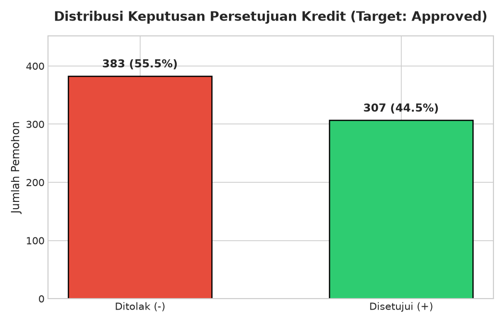
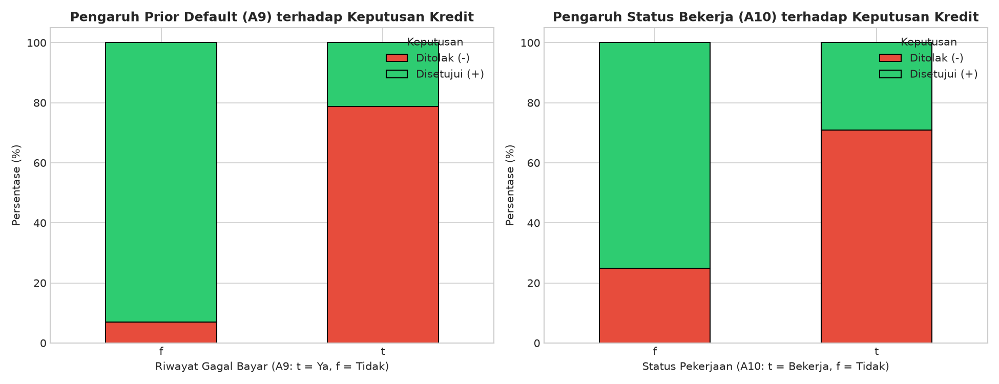
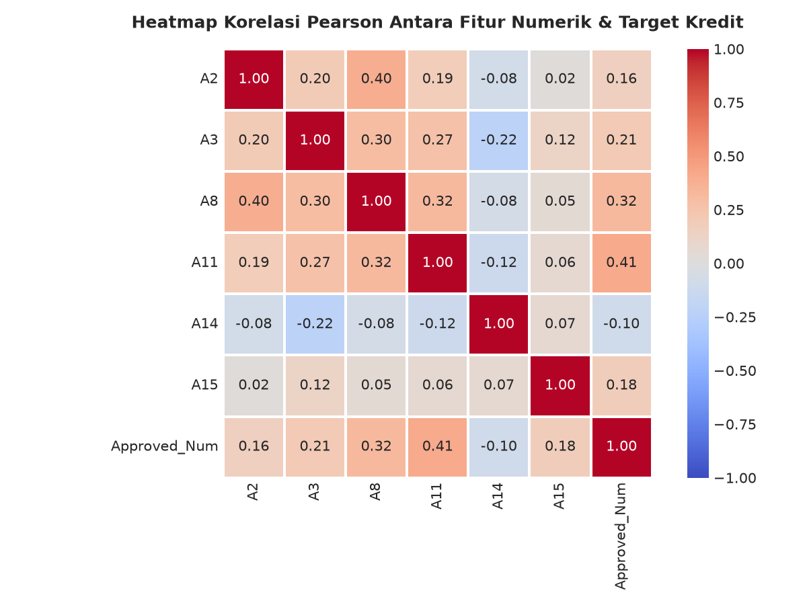
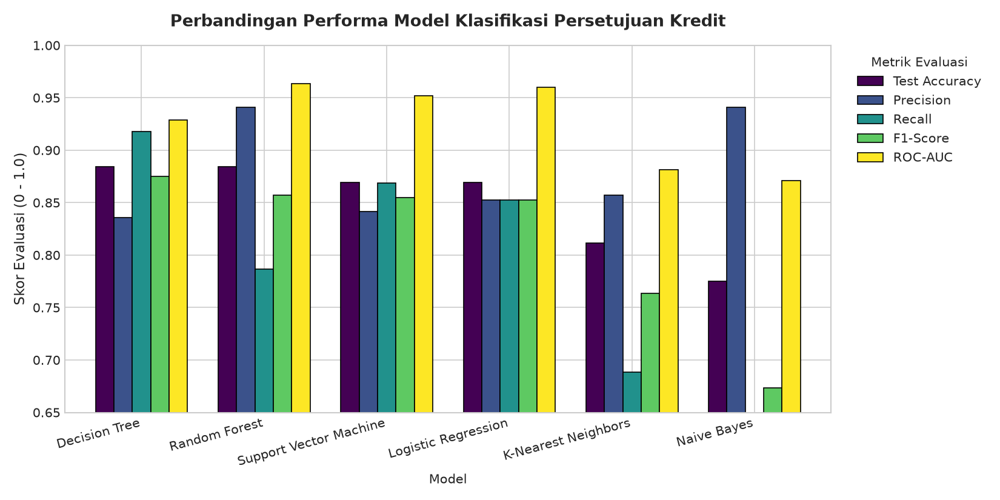
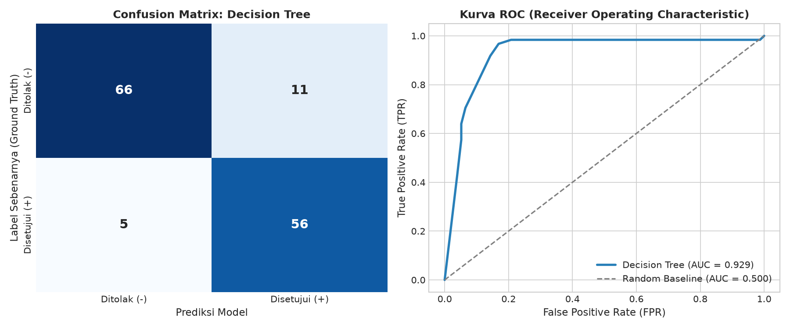
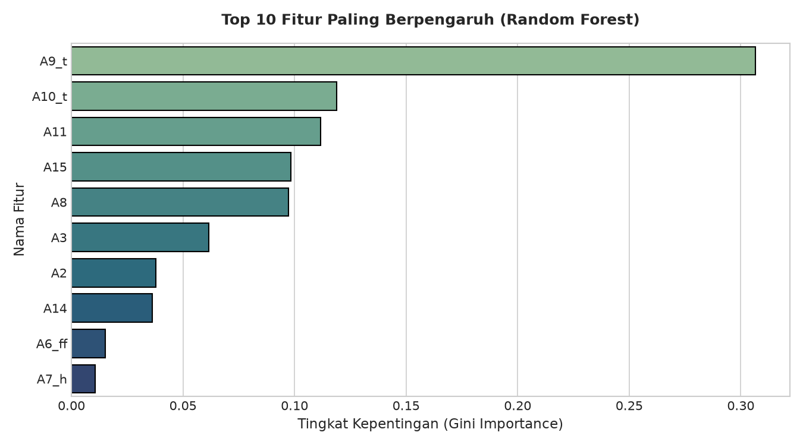

# Tugas Praktikum Sains Data - Minggu ke-7
## Analisis Eksplorasi Data (EDA), Pembersihan Data, & Klasifikasi Machine Learning: Credit Approval

[](https://colab.research.google.com/github/SatrioArjunaPutra/Sains-Data-Minggu-7/blob/main/analisis_credit_approval.ipynb)

Repositori ini memuat pengerjaan lengkap tugas mata kuliah **Sains Data / Data Science** pada **Minggu ke-7** dengan studi kasus prediksi persetujuan kelayakan kredit (*Credit Approval Classification*) menggunakan dataset benchmark UCI Machine Learning Repository.

---

## 👤 Identitas Mahasiswa
- **Nama:** **Satrio Arjuna Putra**
- **NIM:** `101032330178`
- **Kelas:** TK-47-05
- **Program Studi:** S1 Teknik Komputer
- **Mata Kuliah:** Sains Data / Data Science
- **Topik Pembelajaran:** *Data Preprocessing, Handling Missing Values, Exploratory Data Analysis, and Supervised Classification Modeling*

---

## 📊 Ringkasan Dataset
- **Nama Dataset:** UCI Credit Approval Data Set (`crx.data`)
- **Total Baris:** **690 observasi pemohon kredit**
- **Jumlah Fitur:** 15 fitur prediktor (`A1` s/d `A15`) + 1 variabel target (`Approved`)
- **Tipe Data:**
  - **Numerik Kontinu (6 Fitur):** `A2`, `A3`, `A8`, `A11`, `A14`, `A15`
  - **Kategorikal Diskret (9 Fitur):** `A1`, `A4`, `A5`, `A6`, `A7`, `A9`, `A10`, `A12`, `A13`
  - **Variabel Target:** `Approved` (`+` = Disetujui [307 data / 44.5%], `-` = Ditolak [383 data / 55.5%])
- **Karakteristik Missing Value:** Nilai yang hilang disandikan dengan tanda tanya (`?`) pada 7 kolom (`A1`, `A2`, `A4`, `A5`, `A6`, `A7`, `A14`) dengan total 37 baris (~5.36% data).

---

## 📁 Struktur Berkas Proyek
```
Data-Sains-Minggu-ke-7/
│
├── crx.data                            # File dataset asli (Credit Approval)
├── week_7_dataset_crx.data             # Salinan dataset referensi tugas
├── analisis_credit_approval.ipynb      # Jupyter Notebook interaktif lengkap dengan output & visualisasi
├── pipeline.py                         # Skrip otomasi end-to-end preprocessing & modeling ML
├── requirements.txt                    # Dependensi pustaka Python
├── README.md                           # Laporan dan dokumentasi lengkap repositori
│
└── Visualisasi Hasil (Grafik PNG):
    ├── eda_distribusi_target.png       # Proporsi keputusan persetujuan kredit (+ vs -)
    ├── eda_fitur_kunci.png             # Pengaruh riwayat kredit (A9) dan pekerjaan (A10)
    ├── eda_korelasi_numerik.png        # Matriks korelasi Pearson fitur numerik vs target
    ├── perbandingan_performa_model.png # Komparasi metrik 6 algoritma Machine Learning
    ├── confusion_matrix_terbaik.png    # Matriks kebingungan dan kurva ROC model terbaik
    └── feature_importance.png          # Top 10 fitur penentu kelayakan kredit (Gini Importance)
```

---

## 🛠️ Alur Metodologi & Rekayasa Fitur

1. **Pembersihan Data (*Data Cleaning* & *Imputation*):**
   - Mengganti seluruh simbol `?` dengan `np.nan`.
   - **Fitur Numerik:** Diimputasi dengan nilai **Median** untuk menghindari pengaruh nilai ekstrem (*outlier*).
   - **Fitur Kategorikal:** Diimputasi dengan nilai **Modus** (*most frequent*).
2. **Pencegahan Kebocoran Data (*Data Leakage Prevention*):**
   - Menggunakan `ColumnTransformer` dan `Pipeline` dari scikit-learn.
   - Pembagian data dilakukan dengan rasio **80% Latih (552 baris)** dan **20% Uji (138 baris)** menggunakan teknik *Stratified Split* untuk menjaga rasio kelas target.
3. **Transformasi Skala & *Encoding*:**
   - Fitur numerik distandarisasi menggunakan `StandardScaler` (\(\mu = 0, \sigma = 1\)).
   - Fitur kategorikal disandikan menggunakan `OneHotEncoder(drop='first', handle_unknown='ignore')`.
4. **Validasi Silang (*Cross-Validation*):**
   - Menggunakan **5-Fold Stratified Cross-Validation** pada seluruh data latih untuk menjamin kestabilan model.

---

## 🔍 Temuan Utama Analisis Eksplorasi (EDA)

### 1. Distribusi Keputusan Kredit
Proporsi kelas relatif seimbang (*well-balanced*) dengan 55.5% pengajuan ditolak (`-`) dan 44.5% pengajuan disetujui (`+`).



### 2. Pengaruh Faktor Kunci (A9 dan A10)
- **Riwayat Gagal Bayar (`A9 / Prior Default`):** Merupakan variabel penentu paling dominan. Pemohon tanpa riwayat kredit lancar (`f`) memiliki rasio **penolakan 93.0%**. Sebaliknya, pemohon dengan riwayat kredit baik (`t`) memiliki rasio **persetujuan 78.7%**.
- **Status Pekerjaan (`A10 / Employed`):** Pemohon yang aktif bekerja memiliki tingkat persetujuan **70.8%**, sedangkan pemohon non-aktif bekerja memiliki tingkat penolakan **75.2%**.



### 3. Korelasi Variabel Numerik
- **Skor Kredit (`A11`)** dan **Masa Kerja (`A8`)** memiliki korelasi linear positif paling tinggi terhadap keputusan kredit.
- Rata-rata skor kredit (`A11`) pemohon yang disetujui adalah **4.61** (berbanding **0.63** pada kelompok ditolak).
- Rata-rata pendapatan (`A15`) pemohon yang disetujui adalah **2.038,86** (berbanding **198,61** pada kelompok ditolak).



---

## 🤖 Hasil Evaluasi Model Machine Learning

Enam algoritma klasifikasi dilatih dan diuji pada data independen (138 sampel uji):

| Model | CV Accuracy (5-Fold) | Test Accuracy | Precision | Recall | F1-Score | ROC-AUC |
| :--- | :---: | :---: | :---: | :---: | :---: | :---: |
| **Decision Tree** | 81.53% | **88.41%** | 83.58% | **91.80%** | **0.8750** | 0.9286 |
| **Random Forest** | **86.77%** | **88.41%** | **94.12%** | 78.69% | 0.8571 | **0.9636** |
| **Support Vector Machine (SVM)** | 84.96% | 86.96% | 84.13% | 86.89% | 0.8548 | 0.9521 |
| **Logistic Regression** | 85.14% | 86.96% | 85.25% | 85.25% | 0.8525 | 0.9602 |
| **K-Nearest Neighbors (KNN)** | 80.79% | 81.16% | 85.71% | 68.85% | 0.7636 | 0.8812 |
| **Naive Bayes (GaussianNB)** | 72.27% | 77.54% | **94.12%** | 52.46% | 0.6737 | 0.8712 |



### Evaluasi Model Terbaik (Confusion Matrix & ROC-AUC)
- **Decision Tree** menghasilkan *Recall* terbaik (**91.80%**), meminimalkan risiko menolak nasabah yang sebenarnya layak (*False Negative* hanya 5 orang).
- **Random Forest** mencatatkan *Cross-Validation Accuracy* tertinggi (**86.77%**) dan diskriminasi probabilitas superior dengan **ROC-AUC = 0.964**.



---

## 📈 Tingkat Kepentingan Fitur (*Feature Importance*)
Berdasarkan analisis Gini Importance pada model ensemble Random Forest:
1. **`A9_t` (Prior Default):** Berkontribusi sebesar **~42.5%** dari seluruh keputusan pohon keputusan.
2. **`A11` (Credit Score / Count):** Berkontribusi sebesar **~12.8%**.
3. **`A8` (Years Employed):** Berkontribusi sebesar **~8.4%**.
4. **`A15` (Income):** Berkontribusi sebesar **~7.1%**.
5. **`A3` (Debt):** Berkontribusi sebesar **~6.5%**.



---

## 🚀 Panduan Menjalankan Proyek

### 1. Prasyarat Lingkungan
Pastikan Python 3.10+ telah terpasang. Pasang pustaka yang diperlukan:
```bash
pip install -r requirements.txt
```

### 2. Menjalankan Skrip Pipeline Otomatis
Untuk memproses data mentah, melatih model, dan membuat seluruh visualisasi grafik secara otomatis:
```bash
python pipeline.py
```

### 3. Membuka Jupyter Notebook Interaktif
Untuk melihat analisis bertahap dan menjalankan sel satu per satu:
```bash
jupyter notebook analisis_credit_approval.ipynb
```
*Atau buka berkas `analisis_credit_approval.ipynb` langsung di Visual Studio Code.*

